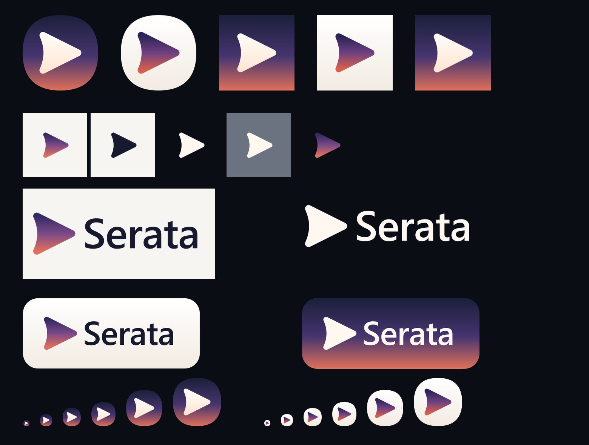

# Serata — icon set

手写的 SVG 图标组，附带全尺寸位图导出。

概念是 **dusk sail（暮色船帆）**：一个指向右侧的播放三角，左边被一条内凹弧切进去 —— 同一条曲线既读作「播放」，又带出弦月的意味。黄昏渐变呼应意大利语 *serata*（夜晚）。



## 目录

```
svg/            12 个矢量源文件（可直接内联或当 ）
png/            91 个位图，按变体分目录
  app-icon-dark/          圆角方形，透明外角
  app-icon-light/
  app-icon-dark-square/   满幅方形，不透明
  app-icon-light-square/
  mark/                   只有图形标志，永远透明
  lockup/                 横排组合
  apple-touch-icon-180.png
overview.png    全变体总览图
preview.html    浏览器预览页
favicon.ico     16 / 32 / 48 / 64 / 128 / 256 六尺寸
tools/          重新生成与校验脚本
```

## 变体矩阵

| 变体 | 底 | 图形 | 外角 | 用途 |
| --- | --- | --- | --- | --- |
| `app-icon-dark` | 黄昏渐变 | 奶白 | 透明 | 主图标；深色界面默认 |
| `app-icon-light` | 象牙白渐变 | 黄昏渐变 | 透明 | 浅色界面 / 浅色模式 |
| `app-icon-dark-square` | 黄昏渐变 | 奶白 | 不透明满幅 | PWA `maskable`、Android 自适应图标、iOS 主屏 |
| `app-icon-light-square` | 象牙白渐变 | 黄昏渐变 | 不透明满幅 | 同上，浅色 |
| `mark-gradient` | 透明 | 黄昏渐变 | 透明 | 深浅底通用的图形标志 |
| `mark-black` | 透明 | `#171A2E` | 透明 | 浅色底单色 |
| `mark-white` | 透明 | `#FFF8F1` | 透明 | 深色底单色 |
| `lockup-on-light` | 透明 | 深色字 + 渐变标志 | — | 浅色底页头 |
| `lockup-on-dark` | 透明 | 奶白字 + 奶白标志 | — | 深色底页头 |
| `lockup-plate-light` | 象牙白圆角板 | 深色字 + 渐变标志 | 不透明 | 卡片、启动图 |
| `lockup-plate-dark` | 黄昏渐变圆角板 | 奶白字 + 奶白标志 | 不透明 | 卡片、启动图 |

尺寸：

- 图标 12 档：`16 32 48 64 96 128 152 180 192 256 512 1024`
- 图形标志 10 档：`16 24 32 48 64 96 128 256 512 1024`
- 横图 3 档宽：`512 1024 2048`

## 配色

| 色值 | 位置 |
| --- | --- |
| `#1B1F3B` | 黄昏渐变 0%　夜空 |
| `#46356F` | 黄昏渐变 55%　暮紫 |
| `#E0705A` | 黄昏渐变 100%　暮色珊瑚 |
| `#332A63` → `#7A4A87` → `#E0705A` | 独立图形标志的渐变 |
| `#2A2356` → `#6E4080` → `#D9604C` | 浅色图标里的图形渐变 |
| `#FFFBF6` → `#FFE7D5` | 奶白图形 |
| `#FFFFFF` → `#F2EBE2` | 象牙白底板 |
| `#171A2E` | 深色字 |
| `#FFF8F1` | 奶白字 |

底衬建议：深色 `#0E1122`，浅色 `#F7F5F2`。

## 用法

```html
<link rel="icon" href="/favicon.ico" sizes="any">
<link rel="icon" href="/svg/favicon.svg" type="image/svg+xml">
<link rel="apple-touch-icon" href="/png/apple-touch-icon-180.png">
```

```json
{
  "icons": [
    { "src": "/svg/app-icon-dark.svg", "sizes": "any", "type": "image/svg+xml" },
    { "src": "/png/app-icon-dark-square/app-icon-dark-square-192.png", "sizes": "192x192", "type": "image/png" },
    { "src": "/png/app-icon-dark-square/app-icon-dark-square-512.png", "sizes": "512x512", "type": "image/png" },
    { "src": "/svg/app-icon-dark-square.svg", "sizes": "any", "type": "image/svg+xml", "purpose": "maskable" }
  ]
}
```

配合 `prefers-color-scheme` 切换深浅版：

```html
<picture>
  <source srcset="/svg/app-icon-light.svg" media="(prefers-color-scheme: light)">
  
</picture>
```

内联当组件用（颜色跟着 `currentColor` 走，需要自行替换 fill）：

```html
<svg viewBox="0 0 512 512" width="24" height="24" aria-hidden="true" style="color:#E0705A">
  <path fill="currentColor" stroke="currentColor" stroke-width="44" stroke-linejoin="round"
        d="M158 146 L378 256 L158 366 Q208 256 158 146 Z"/>
</svg>
```

## 图形构造

在 `512×512` 坐标系里只有一条路径：

```
M158 146 L378 256 L158 366 Q208 256 158 146 Z
```

三角左侧两个直角靠 `stroke-linejoin="round"` + `stroke-width="44"` 圆角化 —— 填充和描边同色，等于把形状外扩 22px 并倒圆角。左边那条 `Q` 是内凹弧，控制点 `x=208`。

改控制点即可调内凹深度：

| 控制点 x | 效果 |
| --- | --- |
| `158` | 直边，普通播放三角 |
| `186` | 极浅 |
| `208` | 当前值 |
| `232` | 明显夸张 |

## 重新生成位图

`tools/` 下三个脚本需要 [sharp](https://sharp.pixelplumbing.com/)。它按顺序从 `$env:SERATA_SHARP`、`%TEMP%\serata-tools`、仓库内 `node_modules` 解析。

```powershell
$env:HTTPS_PROXY='http://127.0.0.1:7890'   # 视网络情况
$dir = Join-Path $env:TEMP 'serata-tools'; New-Item -ItemType Directory -Force $dir | Out-Null
Set-Location $dir; '{"name":"serata-tools","private":true,"type":"module"}' | Set-Content package.json
npm install sharp --no-audit --no-fund

Set-Location <this folder>\tools
node export.mjs     # 重新生成 png/ 和 favicon.ico
node verify.mjs     # 校验尺寸、通道、角像素是否符合命名
node contact.mjs    # 重新拼 overview.png
```

`verify.mjs` 会逐个检查每张 PNG 的实际尺寸、是否带 alpha、四角像素是透明还是不透明 —— 也就是确认 `-square` 真的是不透明、其余真的是透明。

## 已知取舍

- **字标是活字。** `lockup-*.svg` 里的 "Serata" 是 `<text>`，不是路径。字体栈 `Inter → Segoe UI Variable Display → Segoe UI → system-ui`，最终字形取决于系统装了什么。宽度用 `textLength="318"` 钉死，所以任何字体下都不会溢出版面，但**字形本身会变**；导出的 PNG 是用 librsvg 渲染的，这台机器上落到的是系统回退字体，和浏览器里看到的可能不是同一款。要绝对一致，需要把字标转成路径（并附带所嵌字体的授权）。
- 图标上的奶白渐变用 `gradientUnits="userSpaceOnUse"`，这样填充和描边共用一套坐标，接缝不会错位；底板的渐变用默认的 `objectBoundingBox`。
- 圆角是连续曲率的 squircle 路径，不是 `rect rx`，观感更接近 iOS / macOS。
- `app-icon-*-square` 的图形缩放是 `2.0`（占宽 51.6%），比圆角版的 `2.15`（55.4%）略小 —— 这是为了满足 maskable 图标中央 80% 安全区的要求。
- `app-icon-light` 有一道 `#00000014` 的发丝边，避免象牙白底板在纯白背景上完全消失。缩到 16px 时这道边会消失，不影响。
